# Long & Short — manual de uso

Onde fica: **Carteira › Long & Short**. Para ver tudo funcionando com um exemplo (mesmo com o mercado fechado),
toque em **“Fazer o tour guiado”** no bloco **“Como usar”** ou no convite que aparece na primeira visita. O tour não
registra nada e não mexe na sua carteira.

A tela responde a uma pergunta: **o que eu faço agora?** O app não envia ordens: quem executa é você, na
corretora. Material educacional; não é recomendação de investimento.

## Rotina do dia (4 passos)

1. **Antes do pregão:** preencha o **Plano do dia**: capital e, para cada par, viés, gatilho e exposição direcional
   (0 = neutro). Sem plano o app não libera compras; vendas e zeragens continuam liberadas.
2. **Durante o dia:** olhe só **“Ordens agora”**. Faça de cima para baixo: primeiro as rosas ▼ (reduzem risco),
   depois as verdes ▲ (aumentam).
3. **Na corretora:** ordem limitada no preço indicado. Ao comprar, coloque o stop mostrado. Ao ver
   **“↥ SUBIR STOP”**, suba o stop.
4. **Se a tela ficar rosa cobrindo tudo:** limite do dia ou outra trava crítica. Zere o que for indicado e pare.

**Executei** e **Ignorar** são opcionais. Executei atualiza o painel na hora; sem ele, o painel se atualiza na
próxima foto do BTG. Ignorar tira a ordem da lista por 15 min (2 alertas de risco ignorados em 30 min bloqueiam
entradas até o dia seguinte).

## O que cada cor quer dizer

| Sinal   | Significado                                                   |
| ------- | ------------------------------------------------------------- |
| ▼ rosa  | reduz risco: vender, zerar, cobrir                            |
| ▲ verde | aumenta risco: comprar, aumentar                              |
| ⊘ cinza | bloqueada: as regras ainda não deixam; toque para ver por quê |
| ⚠ âmbar | atenção: perto de um limite, dado aproximado, pré/pós-mercado |
| ✓ cinza | tudo certo (aqui verde nunca quer dizer “ok”)                 |

## Regras que o app aplica sozinho

- Sem plano do dia, nada de compra. Venda e zeragem sempre liberadas.
- Perdeu 2% do capital no dia: manda zerar tudo e trava compras até o dia seguinte.
- Nunca aumentar uma ponta que está perdendo (preço médio para baixo é proibido).
- Pré e pós-mercado: só ordem limitada, metade do tamanho; no pós, só reduzir.
- Qualquer dúvida sobre um número: toque no ⓘ ao lado dele (o que é · como ler · o que fazer).

## Tour guiado com o exemplo (SOXL × SQQQ, capital US$ 25.000)

| Passo | O que mostra                                                                                                                | Tela                     |
| ----- | --------------------------------------------------------------------------------------------------------------------------- | ------------------------ |
| 1     | **Onde estamos no dia**: sessão, hora em NY e Brasília, próximo marco, travas                                               | 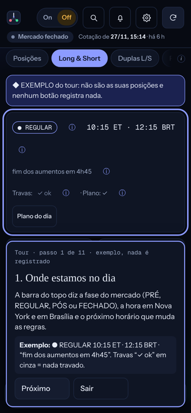 |
| 2     | **Plano do dia**: capital 25.000; viés alta; gatilho “SOXX acima de 250”; direcional 0,3                                    | 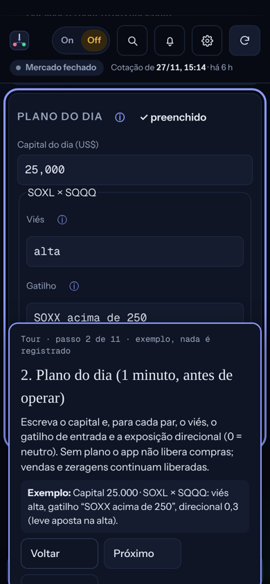 |
| 3     | **Números da carteira**: P&L +US$ 101,70 (+0,81R), limite restante US$ 601,70, 1R = US$ 125                                 | 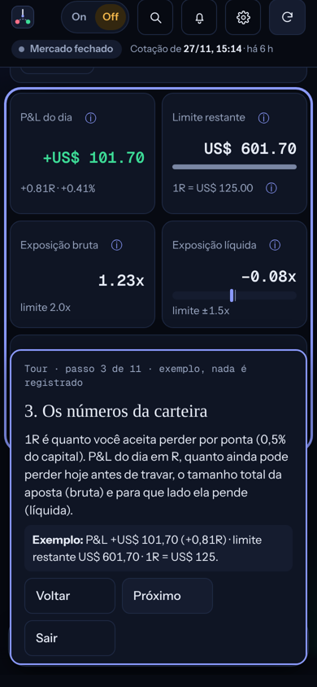 |
| 4     | **Ordens agora**: “▼ VENDER 92 SQQQ · limite 19,70 · P3”: o SOXL ganha +1,48R e o SQQQ perde −0,66R; corta 1/3 da perdedora | 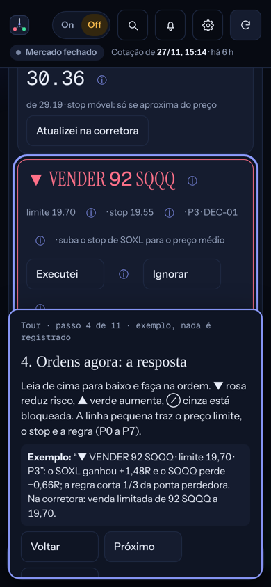 |
| 5     | **Subir o stop**: “↥ SUBIR STOP SOXL para 30,36”                                                                            | 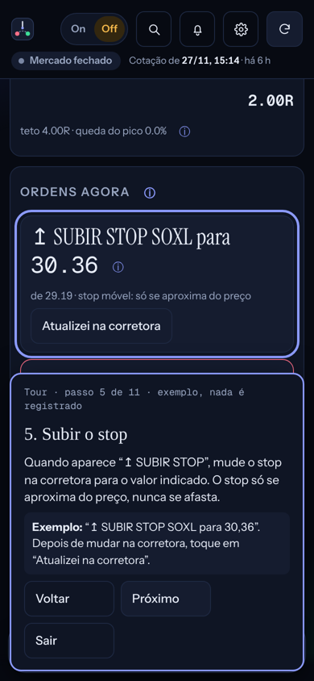 |
| 6     | **Bloqueada**: “⊘ comprar 46 SOXL — aguarda reduzir a perdedora”; libera depois da venda e do rompimento                    | 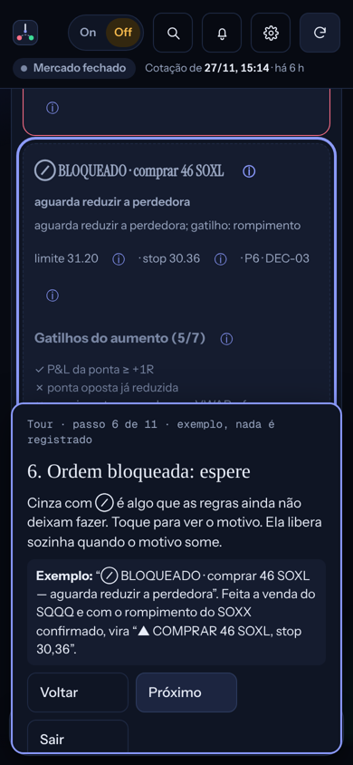 |
| 7     | **Executei / Ignorar**: opcionais                                                                                           | 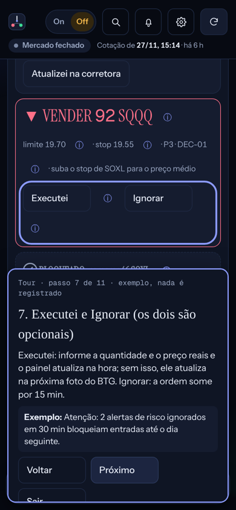 |
| 8     | **Cartão do par**: cenário 1 (long certo, short errado), P&L de cada ponta, stop editável, detalhes                         | 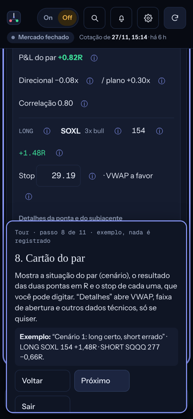 |
| 9     | **Alertas**: só os que valem agora (‼ crítico, → ação, ⚠ atenção)                                                           | 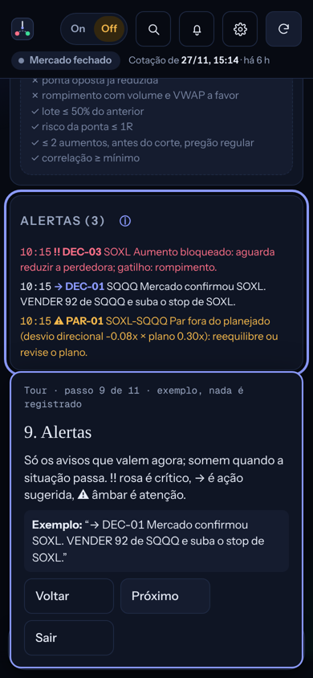 |
| 10    | **ⓘ em tudo**: o que é · como ler · o que fazer                                                                             | 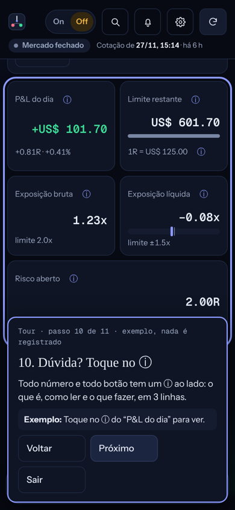 |
| 11    | **Rotina em 4 passos** (bloco “Como usar”)                                                                                  | 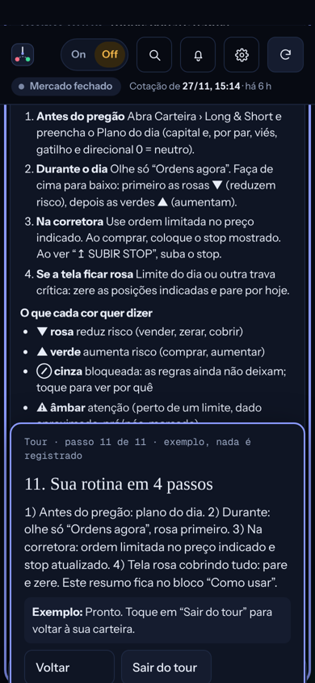 |
